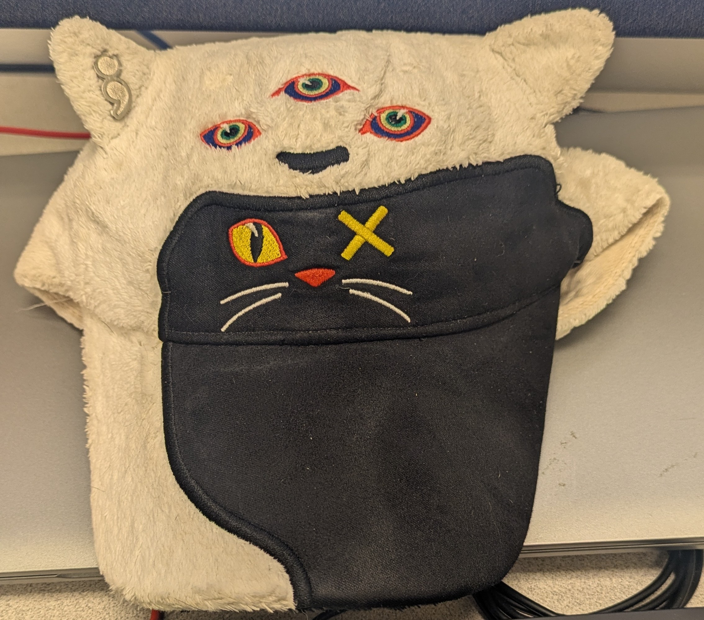

# README - Summary

 
Click to expand of the Summary Section

Hey! I'm Erik Rodriguez, a Computer Science student at IU South Bend and an IT Consultant. I enjoy messing around with technology, coding random projects, and figuring out how things work. My GitHub is basically a collection of personal projects, schoolwork, and ideas I decided to try out. Outside coding, I enjoy gaming, tennis, and hanging out with friends

# THE VERY PROFESSIONAL LAYOUT 
> **Apologies I am still learning to be a professional looking person, but I *LOVE* my hoodies AND cute hats**

 
Wanna see the cute hat in question?

 

   
 

**ERIK RODRIGUEZ**
> Software Developer | IT Professional
